# CLRS-30 Circuit Tracer

An interactive viewer that opens up small neural networks (128-hidden message-passing networks, MPNNs) trained to execute twelve classic graph algorithms from the **CLRS-30** benchmark. Pick an algorithm, step through its execution on a random graph, click a node, and see an **attribution graph**: which sparse features, carried on which sender → receiver message, produced the network's prediction there.

**Live:** http://98.86.163.27/ (main page) · http://98.86.163.27/demo (previous node-site version) · http://98.86.163.27:8080/viewer_fig47.html (Figure 4 / 7 study). Plain HTTP; Chrome may warn about this, see [docs/12](docs/12-operations-runbook.md).

The twelve algorithms: bfs, dfs, bellman_ford, dijkstra, dag_shortest_paths, mst_prim, mst_kruskal, topological_sort, articulation_points, bridges, strongly_connected_components, floyd_warshall.

> **This README is the map.** Each section answers "where does this come from and which file does it". The full detail is in [`docs/`](docs/README.md) (about 7,500 lines: glossary, every file, every algorithm, formulas, formats, server, AWS, workflows, tests, runbook, history, FAQ).

---

## Contents

1. [The most important thing to know: three kinds of data](#1-the-most-important-thing-to-know-three-kinds-of-data)
2. [System at a glance](#2-system-at-a-glance)
3. [What happens when the page opens](#3-what-happens-when-the-page-opens)
4. [Each part of the page: where its data comes from](#4-each-part-of-the-page-where-its-data-comes-from)
5. [The simulation](#5-the-simulation)
6. [The pseudo-code pane](#6-the-pseudo-code-pane)
7. [The MPNN (what the weights compute)](#7-the-mpnn-what-the-weights-compute)
8. [The transcoder and the attribution graph](#8-the-transcoder-and-the-attribution-graph)
9. [Feature meanings (latents)](#9-feature-meanings-latents)
10. [Interventions](#10-interventions)
11. [Which file controls which feature](#11-which-file-controls-which-feature)
12. [Repository layout](#12-repository-layout)
13. [Server, caching and latency](#13-server-caching-and-latency)
14. [Build, deploy and AWS](#14-build-deploy-and-aws)
15. [Tests and verification](#15-tests-and-verification)
16. [Run it locally](#16-run-it-locally)
17. [Honest limits](#17-honest-limits)
18. [Earlier research findings (node-site study)](#18-earlier-research-findings-node-site-study)
19. [References and licence](#19-references-and-licence)

---

## 1. The most important thing to know: three kinds of data

Everything on the page falls into one of these. The diagrams below colour-code them the same way.

| tag | what it is | where it comes from | changes with the model? |
|---|---|---|---|
| **A. Reference algorithm** | The ordinary, textbook algorithm run by DeepMind's CLRS library: the graph, the true state of the algorithm at every step ("hints"), the true answer. | `/api/instance` on the server (`model_export.build_instance`, which calls `clrs.build_sampler`) | no |
| **B. MPNN weights** | The trained 128-hidden network. It reads the same graph and predicts the next state. | `checkpoints_v3/<algo>/best.pkl`, exported at image build time to `models/<algo>.json` + `.bin` and run **in the browser** by `mpnn.js` | yes |
| **C. MPNN transcoder** | A sparse (1,280-feature, 8 active) re-expression of the network's message function, trained afterwards. | `edge_tc/<algo>.bin` + `.json`, run in the browser by `clrs-edge-attrib.js` | yes |
| **D. Stored measurements** | Numbers measured once, offline: training scores, transcoder quality, what each feature means. Displayed, not recomputed by the page. | `edge_tc/clrs-edge-summary.json`, `edge_tc/<algo>.latents.json`, constants `SUMMARY_V3` / `TRAIN_V3` in `viewer3.html` | yes (re-measured) |
| **E. Text** | Explanations, hover cards, algorithm descriptions. | `explain.js`, strings in `viewer3.html` and `verification/pseudo/pseudo_block.js` | no |

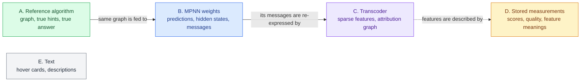

**Two consequences worth remembering:**

- The coloured nodes in the **Simulation** and the **Pseudo-code** are tag **A**: they show what the real algorithm does, not what the network predicts. The network's predictions appear in the *Per-node predictions* table and drive the *Attribution graph*.
- The attribution graph is **computed live in your browser** for the node you click (tags A + B + C). The feature *meanings* and the quality numbers are **stored** (tag D) because measuring them takes minutes.

---

## 2. System at a glance

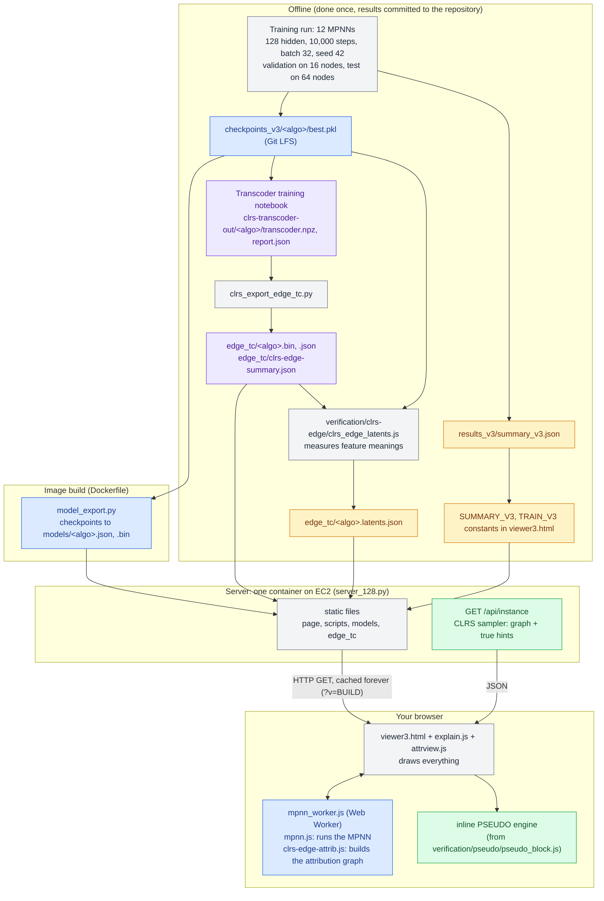

Notes on the picture:

- The browser does the heavy lifting. The server only sends files and samples a graph, so one small machine (t3.small) is enough.
- `models/*.bin` is **not** stored in git; it is generated from the checkpoints when the Docker image is built (`RUN python model_export.py models`).
- `start.sh` starts a second, separate process in the same container: a small static file server for the Figure 4/7 study (`fig47/static_server.py`, port 8767 in the container, published on host port 8080).

---

## 3. What happens when the page opens

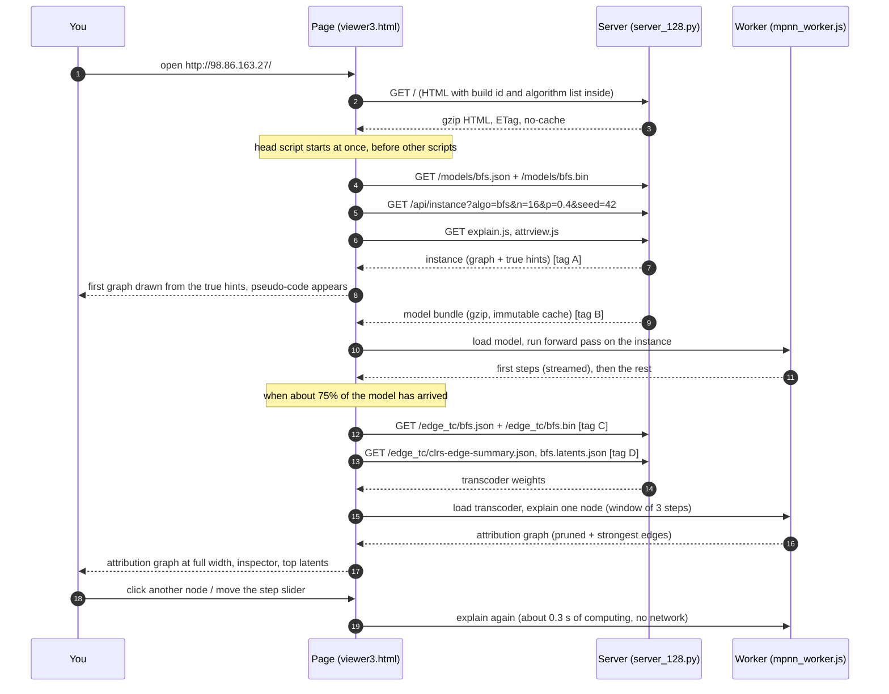

The first load downloads about 2.5 MB for bfs (model about 1.1 MB and transcoder about 1.2 MB, both gzip-compressed, plus the page, scripts, feature table and summary). Later visits use the browser cache (files are immutable for a given build), so only the HTML is revalidated. Other algorithms are prefetched quietly in the background while you read, and pause when you interact.

---

## 4. Each part of the page: where its data comes from

| part of the page | tag | computed live? | data | computed by | drawn by |
|---|---|---|---|---|---|
| Algorithm card ("About this algorithm") | D + E | no | training scores, gap CLEAN/SEVERE, why the output type | `SUMMARY_V3`, `TRAIN_V3` (from `results_v3`) | `renderAlgoInfo` in `viewer3.html` |
| Graph size / seed inputs | A | yes | graph sampled by the CLRS library | `server_128.py` → `model_export.build_instance` | `viewer3.html` |
| **Simulation** (circle of nodes, colours, rings) | **A** | no | the algorithm's own true hint for each step | CLRS reference algorithm | `drawGraph`, `colorForNode` in `viewer3.html` |
| Step slider, Play | – | – | step number | – | `viewer3.html` |
| **Pseudo-code** (highlighted line, nesting colours, loop values) | **A** | no | the same true hints, mapped to the textbook line | `PSEUDO.forStep` (`verification/pseudo/pseudo_block.js`, inlined) | `renderPseudo` in `viewer3.html` |
| Per-node predictions table | A + **B** | yes | true hint vs. the network's prediction vs. true next value | `mpnn.js` (worker) | `renderNodeTable` |
| **Attribution graph** | **A + B + C** | **yes**, per click | features, error nodes, leaves, bias, weighted edges | `clrs-edge-attrib.js` (worker) | `attrview.js` |
| Question line and prediction chips | B | yes | the network's output probabilities for the clicked node | worker | `attrview.js` |
| Quality note (FVU, retention) | **D** | no | measured when the transcoder was trained | `edge_tc/clrs-edge-summary.json` | `renderEdgeNote` |
| Top latents at each step | C + D | yes + stored | strongest features of the pruned graph, with their stored meaning | worker + `<algo>.latents.json` | `renderTopLatents` in `attrview.js` |
| Latent dictionary | **D** | no | best-understood features of this algorithm | `<algo>.latents.json` | `renderDictionary` |
| Message map | C | yes | influence of each sender → receiver message | pruned graph | `renderMessageMap` |
| Inspector (hover / pin a node) | C + D | yes + stored | activation, influence, firing rate, meaning, strongest activations | worker + `<algo>.latents.json` | `avInspect` |
| Intervention (clamp, ablate, amplify) | **B + C** | **yes** | real network re-run with a message changed vs. the graph's prediction | `intervene` in `clrs-edge-attrib.js`, `mpnn.js` | `avIntervene`, `avIvResult` |
| Model & transcoder panel | **D** | no | sizes, tier, FVU, dead features, winner flips ... | `edge_tc/clrs-edge-summary.json` | `renderEtcPanel` |
| Hover cards (dotted words) | E | no | definitions | `explain.js` | `explain.js` |
| How to read the attribution graph | E | no | nine-bullet guide | – | inside the attribution panel in `viewer3.html` |

Every hover text is listed in [docs/06b](docs/06b-hover-text-catalog.md); every part of the page is described in [docs/06](docs/06-page-reference.md).

---

## 5. The simulation

The simulation shows the **real algorithm**, not the network. Its colours come from the CLRS library's reference run; the network is compared against it in the table below the graph.

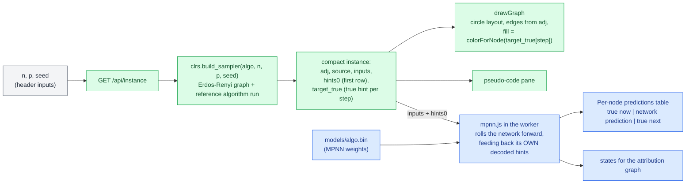

- **Colour rule** (`colorForNode`): mask / mask_one targets are green when true; categorical targets use one colour per class; scalar targets use a blue intensity relative to the row. The source node is orange.
- **Early look.** The tiny `/api/instance` answer arrives long before the model, so the graph is drawn at once; the network's columns fill in when the worker finishes (`G._preview` in `viewer3.html`).
- **Seeds.** The same `(algo, n, p, seed)` always gives the same graph, so typing a seed reproduces an example exactly.
- **What the network is fed.** Only the first hint row (`hints0`) comes from the reference; after that the network reads *its own* decoded hints (soft feedback), as it does at test time. (`runGen` in `mpnn.js`; an option lets tests feed true hints instead.)

---

## 6. The pseudo-code pane

Tag **A** only. The network is not involved.

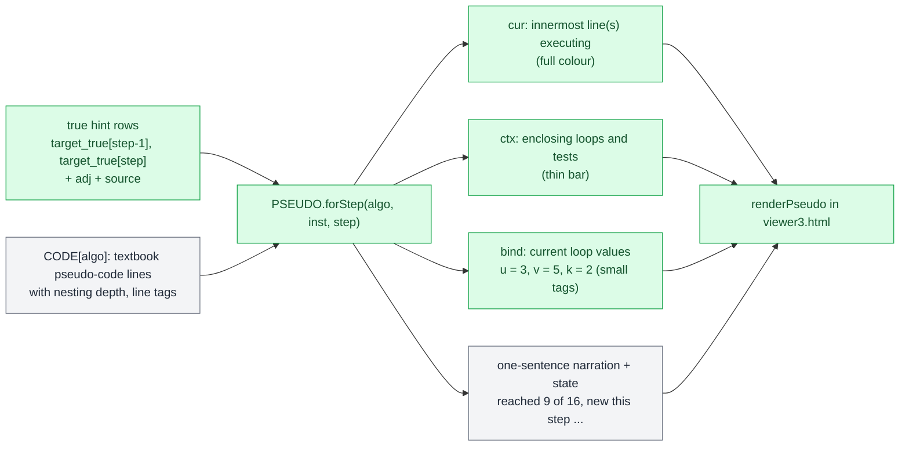

- Comparing a hint row with the previous one tells what the algorithm just did; that row pair is mapped to the line it came from. Where one row is not enough (Dijkstra, Prim, Kruskal, bridges, articulation points) the missing detail is rebuilt from the graph and used **only if it agrees with the recorded trace**; otherwise the plain version is shown.
- Colours show nesting depth (level 1 blue, 2 green, 3 amber, 4 violet, 5 pink); only the innermost line is bright, so in a three-level loop only the third level is highlighted.
- Source of truth: `verification/pseudo/pseudo_block.js`. It is copied into `viewer3.html`; `verification/pseudo/check_inline.js` fails if the copy drifts. `test_pseudo.js`, `truth_pseudo.js` and `test_visual.js` test the lines, the trace agreement and the visuals. See [docs/11](docs/11-testing-and-verification.md).

---

## 7. The MPNN (what the weights compute)

The network is the standard CLRS encode-process-decode MPNN with a fully connected graph (every ordered pair sends a message), **max** aggregation, LayerNorm, and hint feedback. `mpnn.js` reproduces it exactly in JavaScript (`capture_net.py` is the Python original used for checking).

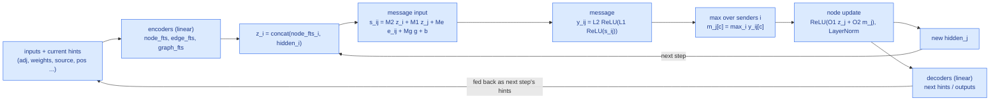

The **message site** (`s_ij` → `y_ij`) is what the transcoder replaces. Training details: 128 hidden, 10,000 steps, batch 32, Adam (learning rate 0.001), seed 42, teacher forcing 0.5; validation on 16-node graphs, test on 64-node graphs. Scores per algorithm are in [docs/04](docs/04-the-12-algorithms.md). Formulas with code locations: [docs/05](docs/05-model-and-math.md).

Weights are shipped to the browser as `models/<algo>.json` (layout, field list) + `models/<algo>.bin` (float32). Format: [docs/07](docs/07-data-files-and-formats.md).

---

## 8. The transcoder and the attribution graph

**Transcoder (tag C).** For every sender → receiver pair at every step, it reads the message input `s_ij` and rebuilds the message `y_ij` from a wide, sparse code: `D = 1280` features, only the `k = 8` strongest kept (TopK). Few active features means each can be inspected. What it fails to rebuild is kept as an explicit **error node**, so the replacement reproduces the real network exactly.

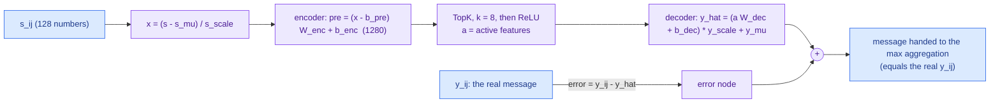

**Attribution graph (A + B + C, computed per click).** For the clicked node at a step, the page traces its prediction back over a window of three steps. With the max-aggregation winners, the LayerNorm σ and the ReLU pattern frozen at their real values on this input, every quantity is a *linear* function of the quantities one step earlier. So each feature's value equals the sum of its incoming edges (weight = source value × its effect), plus error nodes, encoder leaves (inputs and fed-back hints), an "earlier state" leaf, and a bias node.

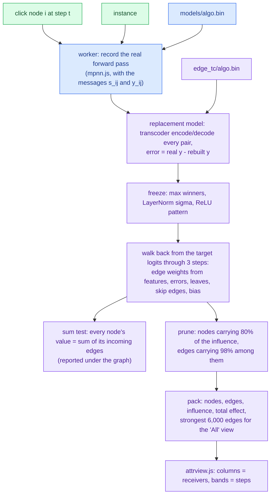

How to read the drawing (also inside the page): latents are circles in the column of the *receiver*, coloured by the kind of pair (real edge, non-edge, self pair); hatched squares are error nodes; small squares are leaves; the diamond is the bias; blue edges push the target up, red down. `Pruned / All`, `By node / Supernodes / By meaning` change the view. The line under the graph states the largest sum-test difference over every node shown. Full formulas: [docs/05](docs/05-model-and-math.md).

---

## 9. Feature meanings (latents)

Most of the 1,280 features have no simple description, and the page does not invent one. A feature gets a name only if a short condition on the graph state predicts when it is active **on graphs the condition was not fitted on**. This is measured offline and stored (tag **D**).

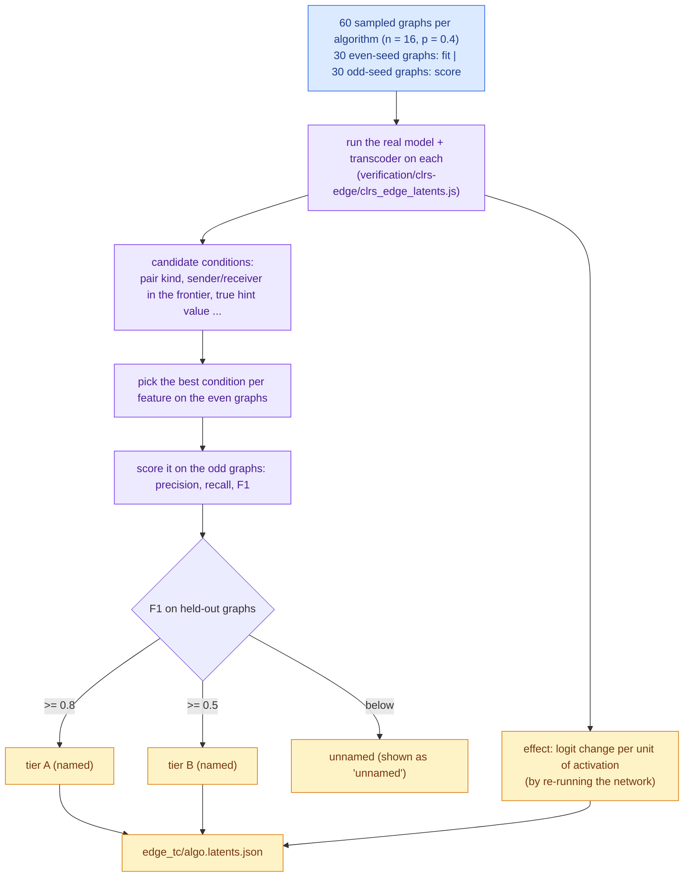

Per algorithm, between 3 and 18 of roughly 650 to 1,190 features that fire are named. The complete tables are in [docs/15](docs/15-latent-dictionaries.md); the transcoder training reports in [docs/16](docs/16-transcoder-training-reports.md).

---

## 10. Interventions

An intervention **changes one feature's contribution to a message and re-runs the real network**, then compares the real result with what the graph predicted. The three buttons use the factors -1 (clamp), 0 (ablate) and 2 (amplify).

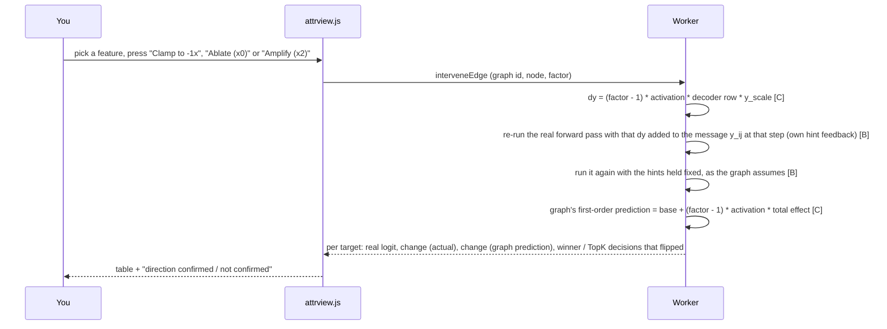

The graph freezes the winners, σ and ReLU pattern, so its prediction is a guide, not a guarantee. Measured over test graphs, its **direction** matched the real change about **69%** of the time; the real column is the one to trust.

---

## 11. Which file controls which feature

| if you want to change ... | edit | then |
|---|---|---|
| the layout of the page, panel order, styles | `viewer3.html` (markup and `<style>`) | `layout_test.mjs`, `pc_test.mjs` |
| how the attribution graph is drawn (columns, colours, hover, pin) | `attrview.js` | `edge_ui_test.mjs`, `ui_truth_test.mjs` |
| how the attribution graph is **computed** | `clrs-edge-attrib.js` (edge site), `attrib.js` (`/demo`, shared helpers) | `test1`–`test9`, `ui_truth_test.mjs`; for a speed-up, compare the packed output bit for bit before and after |
| how the network is run in the browser | `mpnn.js` | `test4_fd.js`, `ui_truth_test.mjs` |
| the worker's messages | `mpnn_worker.js` | – |
| the pseudo-code, narration, loop values | `verification/pseudo/pseudo_block.js`, then copy it into `viewer3.html` | `check_inline.js`, `test_pseudo.js`, `truth_pseudo.js` |
| hover text | `explain.js` (`GL`, `GL_EDGE`) | `tools/clrs_dump_tips.js` regenerates [docs/06b](docs/06b-hover-text-catalog.md) |
| algorithm card text and scores | `SUMMARY_V3`, `TRAIN_V3`, `renderAlgoInfo` in `viewer3.html` | `ui_truth_test.mjs` |
| which graphs are sampled / the API | `server_128.py`, `model_export.py` (`build_instance`) | – |
| caching, compression, routes, memory limits | `server_128.py` | see §13 |
| the transcoder files (re-trained) | `clrs_export_edge_tc.py` → `edge_tc/` | `test1`, `test2`, `test4`, `test8`; re-measure meanings |
| feature meanings | `verification/clrs-edge/clrs_edge_latents.js` → `edge_tc/<algo>.latents.json` | `test9_labels.js` |
| the checkpoints | `checkpoints_v3/` (invalidates **everything** downstream) | redo the whole chain |
| the previous node-site page | `demo.html`, `algos/<algo>/` | `demo_ui_test.mjs` |
| the container, ports | `Dockerfile`, `start.sh` | – |
| deployment | `.github/workflows/*.yml` | [docs/10](docs/10-github-actions.md) |

The per-file description of **every** tracked file is in [docs/03](docs/03-repository-file-map.md).

---

## 12. Repository layout

```
viewer3.html            main page (edge-site transcoder version): markup, styles, page logic, inline pseudo-code engine
demo.html               previous page (node-site transcoder), served at /demo
explain.js              hover cards (definitions, "why it is there", technical notes)
attrview.js             attribution graph drawing, inspector, top latents, dictionary, message map, interventions UI
mpnn.js                 the trained MPNN forward pass, in JavaScript (browser, worker, Node)
mpnn_worker.js          Web Worker: runs the network and builds attribution graphs off the main thread
clrs-edge-attrib.js     edge-site attribution engine (replacement model, graph, pruning, interventions, checks)
attrib.js               node-site attribution engine (/demo) and shared helpers

server_128.py           HTTP server: pages, scripts, models, edge_tc, /api/*  (port 8766 in the container)
model_export.py         checkpoints -> models/<algo>.json/.bin; build_instance (CLRS sampler -> compact instance)
capture_net.py          Python MPNN that exposes inner states (z, messages, hidden)
pipeline.py, config.py  node-site pipeline (activations, transcoder training, labelling); paths and algorithm list
clrs_export_edge_tc.py  clrs-transcoder-out -> edge_tc/ (the files the browser loads)

checkpoints_v3/<algo>/  the 12 trained MPNN checkpoints (Git LFS)
edge_tc/                edge-site transcoder per algorithm (.bin, .json), feature meanings (.latents.json), quality summary
algos/<algo>/           node-site transcoder, feature labels, meta.json (target, type and source field of the algorithm)

fig47/                  Figure 4 / Figure 7 study (node-site), viewer and generators; static_server.py on port 8767
verification/
  clrs-edge/            tests 1-9, truth test, layout test, latent measurement, instance fetcher
  pseudo/               pseudo-code engine source and its tests
  ui/                   browser tests (layout, pseudo-code, edge page, /demo, squeeze, cold-load timeline)
tools/                  clrs_docs_generate.py, clrs_dump_tips.js (regenerate the generated documents)
docs/                   the documentation set (index: docs/README.md)
.github/workflows/      12 manual workflows (build, deploy, update, diagnose, reboot, tune, checks, HTTPS, CloudFront)
Dockerfile, start.sh    the image and what it runs
```

---

## 13. Server, caching and latency

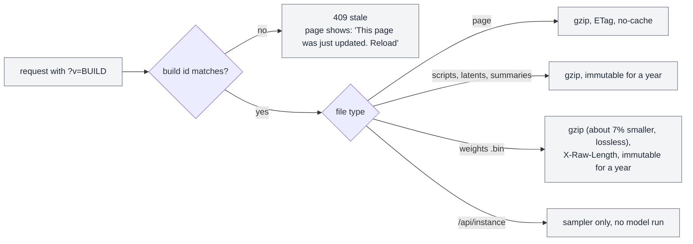

- **Build id**: a SHA-1 over the static files, the models and the edge transcoder files; it is inside every URL. A new deployment changes it; old pages get 409 instead of mixing old scripts with new data.
- **Targets**: at most 2 s, normally below 500 ms; no resizing of the instance; no load tests on the live site.
- **Done to keep it fast:**
  - the model and instance are requested from the HTML head, before any script has loaded;
  - the transcoder is requested while the model is still arriving (at about 75%);
  - pages, scripts, latents and weights are gzip-compressed; weights are immutable-cached;
  - the model runs in a Web Worker, so the page stays responsive; the first two steps are streamed out first;
  - other algorithms are prefetched at low priority, pausing while you interact (`RES_CAP = 4`);
  - the attribution engine's inner loops were tightened without changing a single number (checked bit for bit on all 12 algorithms).
- **Measured** with `verification/ui/latency_test.mjs` (cold cache, emulated link with 250 ms extra round trip, local copy of the page; median of 3 runs). These are emulated conditions, not live measurements:

  | emulated download speed | first graph | model ready | attribution graph (before → after) |
  |---|---|---|---|
  | 450 KB/s | about 0.7 s | about 3.5 s | 6.7 s → 6.0 s |
  | 3,000 KB/s | about 0.56 s | about 0.94 s | 1.8 s → 1.6 s |

  Compute for one click (bfs, 16 nodes, Node): about 325 ms → about 285 ms for the graph itself, with identical output.
- **What would help most next**: the dominant cost for a far-away visitor is round trips, not compute. A CDN in front of the instance (CloudFront, prepared in `.github/workflows/setup-cloudfront.yml`, not applied) would cut them; so would HTTPS with HTTP/2 (prepared in `enable-https.yml`, not applied).

Details: [docs/08](docs/08-server-and-api.md).

---

## 14. Build, deploy and AWS

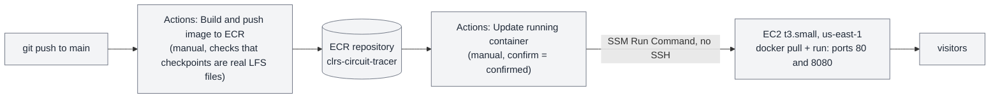

- One **t3.small** in us-east-1 (16 GB gp3 disk, 2 GiB swap), reached only through **SSM** (no SSH, port 22 closed). Security group opens ports 80 and 8080. The container runs with a 1,500 MB memory limit (1,800 MB with swap).
- Twelve workflows, all manual, with confirmation inputs, tag guards (only this project's resources are touched) and pinned action versions: build, deploy, update, diagnose, reboot, network tuning (BBR), pre-demo check, cross-browser check, cleanup, HTTPS, CloudFront, AWS discovery.
- To deploy a change: run **Build and push image to ECR**, then **Update running container**. Rollback, demo checklist, troubleshooting: [docs/12](docs/12-operations-runbook.md). Workflows in detail: [docs/10](docs/10-github-actions.md). Infrastructure: [docs/09](docs/09-aws-infrastructure.md).

---

## 15. Tests and verification

| test | what it proves |
|---|---|
| `test1_port.js` (+ `test1_crosscheck.py`) | the JavaScript transcoder equals an independent numpy implementation on 36 reference rows (identical indices, values equal to 1e-9) |
| `test2_quality.js` | the transcoder reconstructs this model's real messages (error numbers match the training report) |
| `test4_fd.js` (tests 3, 4, 5) | the recorded forward pass replays exactly; edge weights and total effects match finite differences; every node's value equals the sum of its incoming edges |
| `test6_regression.js` | the previous (node-site) graph is unchanged |
| `test7_intervene.js` | interventions behave as specified |
| `test8_replacement.js` | the transcoder inside the real network keeps the reported score |
| `test9_labels.js` | the stored precision, recall and F1 of the feature meanings reproduce |
| `ui_truth_test.mjs` | every number the page shows equals an independent recomputation and the original training files |
| `layout_test.mjs`, `pc_test.mjs`, `squeeze_test.mjs` | layout at three widths (no overflow), one highlighted pseudo-code line per step for every algorithm, attribution graph at full width |
| `edge_ui_test.mjs`, `demo_ui_test.mjs` | the edge page and `/demo` in a real browser |
| `verification/pseudo/*` | the pseudo-code lines, narration and their agreement with the recorded trace |
| `latency_test.mjs` | cold-load timeline under an emulated slow, far-away connection |

How to run them and what each checks: [docs/11](docs/11-testing-and-verification.md) and [VERIFICATION.md](VERIFICATION.md).

---

## 16. Run it locally

```bash
git lfs pull                       # the checkpoints are stored with Git LFS
pip install -r requirements.txt    # jax, dm-haiku, numpy, clrs (Python 3.11)
python model_export.py models      # creates models/<algo>.json/.bin (needed once)
python server_128.py               # open http://localhost:8766/viewer3.html
```

The Figure 4 / 7 study viewer: `cd fig47 && python -m http.server 8767`, then open `http://localhost:8767/viewer_fig47.html`.

To rebuild the generated documents after changing data: `python3 tools/clrs_docs_generate.py --models <models dir> --reports <clrs-transcoder-out> --results <results_v3>`.

---

## 17. Honest limits

- Models trained on 16-node graphs and tested on 64-node graphs: **seven** algorithms generalise (CLEAN, gap below 10 points: bfs, bellman_ford, dijkstra, dag_shortest_paths, mst_prim, articulation_points, bridges) and **five** do not (SEVERE, gap above 40 points: dfs, topological_sort, mst_kruskal, floyd_warshall, strongly_connected_components). The page shows both.
- The attribution graph explains **one prediction on a small graph**. It does not prove the network "understands" the algorithm.
- Unnamed features are **unexplained**, not meaningless.
- The graph's clamp prediction points the right way about 69% of the time; use the measured column.
- Plain HTTP only for now. No user data is collected.

---

## 18. Earlier research findings (node-site study)

These come from the first phase of the project (the node-site transcoder, `fig47/`, `/demo`). They are kept here as written; details in [docs/17](docs/17-fig47-study-results.md).

**Accuracy is not the same as circuit confirmability.** Real OOD test accuracy (`summary_v3.json`) splits the 12 algorithms cleanly into two classes — CLEAN (gap < 0.10: bfs, dag_shortest_paths, dijkstra, bridges, articulation_points, bellman_ford, mst_prim) and SEVERE (gap > 0.40: mst_kruskal, topological_sort, dfs, floyd_warshall, strongly_connected_components) — but this split does **not** predict how confirmable each algorithm's attribution-graph-derived supernodes are under intervention (CLEAN mean 75.4% vs SEVERE mean 71.9% downstream-confirmed, well within noise). `bfs`, the single most accurate model (99.8% test F1), has the *lowest* confirmation rate (55%) of any algorithm tested.

**`floyd_warshall` never learned a coherent circuit.** Its own predicted distance matrix violates the triangle inequality even at in-distribution graph sizes (201 genuine violations, verified against a ground-truth cross-check) — a real failure of the underlying model, not a tooling artifact. It's the one algorithm with no clean baseline to run interventions against.

**A within-category recurring-feature pattern was found and then correctly downgraded.** `bfs` and `topological_sort` initially showed a striking pattern — clamping one feature reliably promotes the same handful of "sibling" features of the same predicate category. Testing this on two further CLEAN algorithms (`dag_shortest_paths`, `mst_prim`) failed to replicate it (50%/67% recurrence vs. the 80% threshold), so the final, honest verdict is **WEAK / isolated** — not a general mechanism. See `fig47/final_finding.json`.

**One real measurement bug was caught and corrected mid-project**: the `bridges` algorithm's reported "17–34% accuracy" was an artifact of comparing against CLRS's `-1` "no edge" sentinel value; the real accuracy is 100% on every valid edge at every tier. A second bug (`'is source'` vs `'is_source'` key mismatch) had silently disabled the "source" supernode across 7 algorithms in every phase until caught via a ground-truth cross-check and fixed. Both are documented in-repo rather than silently corrected.

### The node-site study: directory structure

```
algos/<algo>/           transcoder.npz, feature_labels.json, meta.json  (per algorithm)
capture_net.py          spec-generic MPNN wrapper exposing internal (z, msgs, hidden)
pipeline.py             Phase 2+3+4: activation extraction, transcoder training, labeling
server_128.py           backend for viewer3.html (runs the real jax forward pass on demand)
viewer3.html            interactive attribution-graph explorer, all 12 algorithms
fig47/
  phase0.py             three-layer ground-truth harness (precondition / stage-correctness / invariant checks)
  phase1.py             supernode distillation + frozen pre-registered predictions
  phase2_aggregate.py   15-example intervention sweep per algorithm
  phase2_6.py           diagnostics for the accuracy/confirmability inversion
  phase3_maskchanged.py mask_changed / recurring-feature analysis
  gen_single_example_data.py, graph_engine.py, paper_style.py
  render_fig4_paper.py, render_fig7_paper.py   static PNG generators
  viewer_fig47.html     interactive Figure 4/7 reproduction, all 12 algorithms
  final_finding.json    the final, reconciled verdict on the recurring-feature question
```

---

## 19. References and licence

- Veličković, Badia, Budden, Pascanu, Banino, Dashevskiy, Hadsell, Blundell. *The CLRS Algorithmic Reasoning Benchmark.* ICML 2022 (arXiv:2205.15659). The benchmark, the reference algorithms, the probes and hints, and the 16-node / 64-node split used here.
- Ameisen et al., *Circuit Tracing: Revealing Computational Graphs in Language Models*, and Lindsey et al., *On the Biology of a Large Language Model*, Anthropic, 2025: the attribution-graph method this project applies to an algorithm-executing network.
- Licence: MIT, see [LICENSE](LICENSE).
